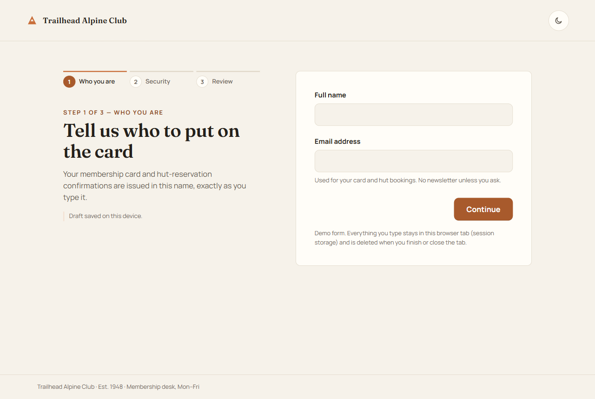
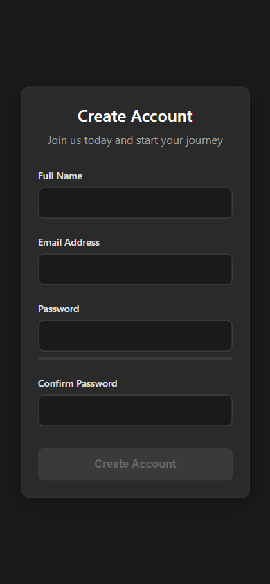
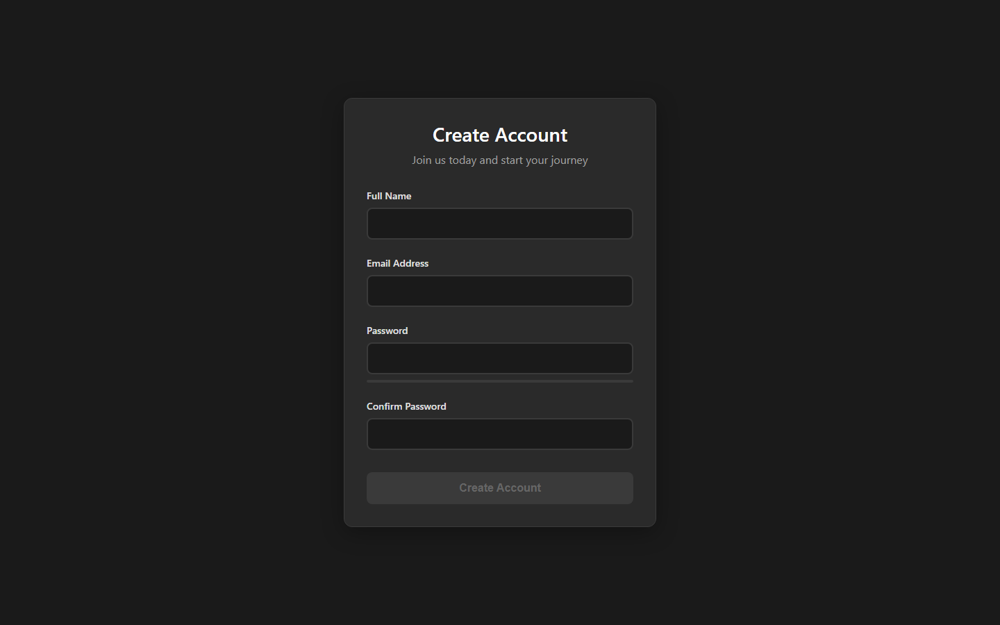
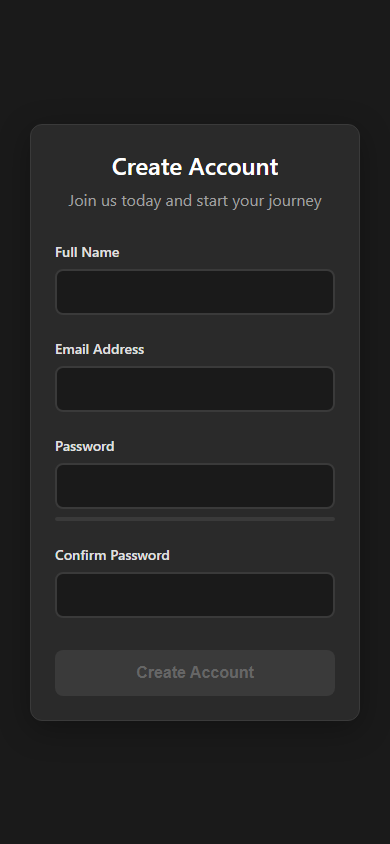

# Smart Registration Form

Registration form with real-time, hand-written validation — no validation library, no browser default popups.

**Live demo:** https://smart-registration-form.vercel.app

<div align="center">


| Desktop | Mobile |
|---|---|
|  |  |

<details>
<summary>More screenshots</summary>

| Desktop | Mobile |
|---|---|
|  |  |

</details>

</div>

## What it does

Every rule lives in a separate `formValidator.js` module; the form is marked `novalidate` on purpose so the browser's unstyleable tooltips never appear. Validation runs on `input` and `blur`, renders inline error messages under the failing field, and the submit button stays blocked until all four fields pass. The markup only carries `data-` hooks, so rules can change without touching the HTML.

## Tech stack

React 19 · TypeScript · Vite

## Features

- Real-time validation on `input` and `blur` for all four fields
- Inline per-field error messages instead of browser tooltips
- Name shape, email format, password strength and confirm-password matching
- Submit gated on a `validationState` object — only fires when every field is valid
- Rules isolated in a reusable `FormValidator` class

## Run locally

```bash
git clone https://github.com/Mister2314/smart-registration-form.git
cd smart-registration-form
npx serve .        # or just open index.html
```

## What I learned

Turning off the browser's own validation was the point of the exercise — it is the only way to control what the user actually sees when a field is wrong.
