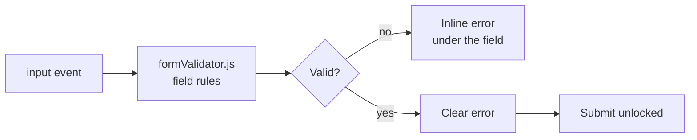

<h1 align="center">Smart Registration Form</h1>

<p align="center"><b>A registration form with real-time validation written from scratch — no validation library, no browser default popups.</b></p>

<p align="center">
[](https://elegant-pastelito-6c3353.netlify.app/)


</p>

<p align="center">[**Live demo**](https://elegant-pastelito-6c3353.netlify.app/) · [Quick start](#quick-start) · [Features](#features) · [Architecture](#architecture) · [FAQ](#faq)</p>

<p align="center">
  <a href="https://elegant-pastelito-6c3353.netlify.app/">
    
  </a>
</p>

<p align="center"><sub>Live capture of the real build — 547 KB, loops forever.</sub></p>

## Overview

A sign-up form where every rule is written by hand in a separate validator module. The form is marked `novalidate` on purpose — instead of letting the browser throw its own tooltips, validation runs on input and renders inline error messages under the relevant field.

`formValidator.js` holds the rules for each field: name shape, email format, password strength and confirmation matching. Errors appear and clear as you type, and the submit button only proceeds once every field is valid.

## At a glance

| Field | Detail |
| --- | --- |
| **Type** | Static site — no build step |
| **Primary language** | HTML |
| **Live demo** | [elegant-pastelito-6c3353.netlify.app](https://elegant-pastelito-6c3353.netlify.app/) |
| **Repository** | [Mister2314/smart-registration-form](https://github.com/Mister2314/smart-registration-form) |

## Features

- Real-time validation on every field as the user types
- Inline, per-field error messages instead of browser tooltips
- Email format checking and name validation
- Password strength rules plus confirm-password matching
- Submit blocked until the form is fully valid
- Validation rules isolated in a reusable `formValidator.js` module
- Clean card layout with a soft pastel palette

## Tech Stack

| Layer | Technology |
| --- | --- |
| Markup | HTML5 (`novalidate` form) |
| Styling | CSS3 |
| Logic | Vanilla JavaScript validation module |
| Deploy | Netlify |

## Architecture



## Screenshots

| Desktop | Mobile |
| :---: | :---: |
|  |  |

## Quick Start

```bash
git clone https://github.com/Mister2314/smart-registration-form.git
cd smart-registration-form

# open it directly
start index.html      # Windows
open  index.html      # macOS

# or serve the folder
npx serve .
```

## Project Structure

```
index.html — form markup with data- hooks for the validator
formValidator.js — field rules and validation orchestration
styles.css — card layout and error-state styling
```

## FAQ

<details>
<summary><b>Why is the form `novalidate`?</b></summary>

Because the browser's own tooltips cannot be styled or positioned. Turning them off is the only way to control what the user actually sees when a field is wrong.

</details>

<details>
<summary><b>Where are the rules defined?</b></summary>

In `formValidator.js`, one entry per field. The markup only carries `data-` hooks, so rules can change without touching the HTML.

</details>

<details>
<summary><b>Does it check password confirmation?</b></summary>

Yes — the confirm field is validated against the password field on every input event.

</details>

## Roadmap

- [ ] Add a password strength meter
- [ ] Add an async check for already-registered emails
- [ ] Add keyboard-only and screen-reader tests

## Notes

Turning off the browser's own validation was the point of the exercise — it is the only way to control what the user actually sees when a field is wrong.

## Author

**Xəyal Hüseynli** — Junior Front-End Developer

[Portfolio](https://hypnosdev.vercel.app) · [GitHub](https://github.com/Mister2314) · [LinkedIn](https://www.linkedin.com/in/x%C9%99yal-h%C3%BCseynli-3487b91ba/) · [xeyalhuseynli06@gmail.com](mailto:xeyalhuseynli06@gmail.com)
